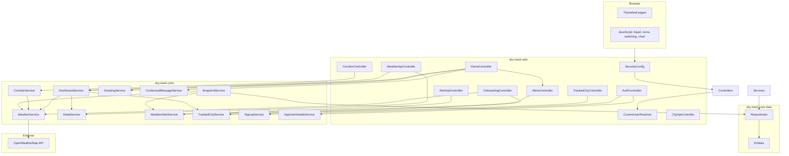
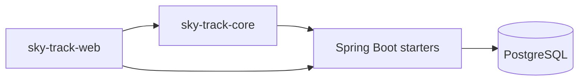

# 01 — Architecture

This page shows how the pieces of Sky Track fit together. It is the "big picture" that the rest of the map fills in.

## Layers

The application is organized in layers, from the browser down to the database.

```
┌─────────────────────────────────────────────────────────────┐
│  BROWSER                                                    │
│  renders HTML (Thymeleaf) + runs JS (liquid bg, switching)  │
└──────────────────────────────┬──────────────────────────────┘
                               │ HTTP (GET/POST)
┌──────────────────────────────▼──────────────────────────────┐
│  WEB LAYER  (sky-track-web)                                 │
│  SecurityConfig — auth + public-path rules                   │
│  CurrentUserResolver — who is logged in                      │
│  Controllers — MVC pages + REST JSON APIs                    │
└──────────────────────────────┬──────────────────────────────┘
                               │ calls
┌──────────────────────────────▼──────────────────────────────┐
│  SERVICE LAYER  (sky-track-core)                            │
│  WeatherService → OpenWeatherMap                             │
│  SnapshotService / DeltaService / WeatherAlertService        │
│  TrackedCityService / CorridorService                        │
│  GreetingService / ContextualMessageService                  │
│  SignupService / AppUserDetailsService                       │
└──────────────────────────────┬──────────────────────────────┘
                               │ uses
┌──────────────────────────────▼──────────────────────────────┐
│  DATA LAYER  (sky-track-core)                               │
│  JPA Entities (model/)                                      │
│  Spring Data Repositories (repository/)                     │
└──────────────────────────────┬──────────────────────────────┘
                               │ SQL
┌──────────────────────────────▼──────────────────────────────┐
│  POSTGRESQL DATABASE (via Docker, Flyway migrations)        │
└─────────────────────────────────────────────────────────────┘
```

## Component diagram



## Module dependency



`sky-track-core` knows nothing about the web. `sky-track-web` depends on core and adds controllers, security, templates, and static assets.

## Dependency injection

Spring Boot wires the whole graph with **constructor injection**. Every service and controller declares its dependencies as `private final` fields and receives them through the constructor. For example:

```java
public class HomeController {
    private final CurrentUserResolver currentUserResolver;
    private final DashboardService dashboardService;

    public HomeController(CurrentUserResolver currentUserResolver, DashboardService dashboardService) {
        this.currentUserResolver = currentUserResolver;
        this.dashboardService = dashboardService;
    }
}
```

Spring finds the beans by type and injects them. This is why the whole chain can be followed by reading constructors.

## Security posture

- Only `/signup`, `/login`, `/css/**`, `/js/**` are public.
- Everything else requires an authenticated session.
- Login uses `email` as the username parameter.
- Passwords are BCrypt-hashed in `app_users.password_hash`.
- Data is scoped per user: tracked cities and alerts always resolve the current user.

## Configuration flow

`application.yml` (and `application-prod.yml`) provide values that Spring binds to `@ConfigurationProperties` (e.g. `WeatherApiProperties`), then services read via injection. Secrets come from environment variables, never from committed files.

Next: [02-request-lifecycle.md](02-request-lifecycle.md)
