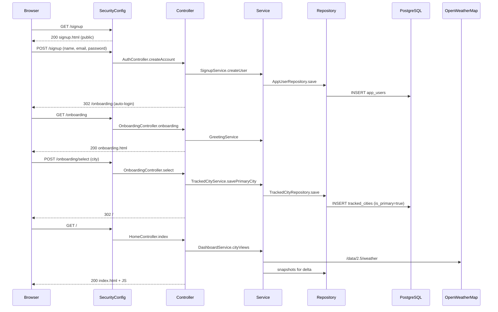

# 02 — Request Lifecycle

This page walks one real user journey through the entire stack, step by step. Each step names the actual class and file involved.

## Journey: a brand-new user signs up and reaches the dashboard

### Step 1 — GET /signup (public)

The browser requests the signup form.

1. `SecurityConfig` lets the request through (public path).
2. `AuthController.signup(Model)` runs, adds an empty `SignupRequest` and the `themeClass` to the model.
3. Thymeleaf renders `templates/auth/signup.html` using the `head` fragment (fonts + CSS).
4. The form HTML is returned with a hidden CSRF token.

### Step 2 — POST /signup

The user submits first name, last name, email, and password.

1. `AuthController.createAccount(...)` receives the bound `SignupRequest` with `@Valid` validation.
2. If validation fails, the form re-renders with errors.
3. `SignupService.createUser(...)` runs:
   - normalizes the email,
   - rejects duplicate emails (`EmailAlreadyRegisteredException`),
   - maps the DTO to an `AppUser` entity,
   - hashes the password with BCrypt,
   - saves via `AppUserRepository`.
4. `AuthenticationManager` authenticates the new user immediately (auto-login).
5. `HttpSessionSecurityContextRepository` stores the security context in the session.
6. The user is redirected to `/onboarding`.

### Step 3 — GET /onboarding

1. `OnboardingController.onboarding(...)` runs; it is protected, but the session is now authenticated.
2. `CurrentUserResolver.currentUser(...)` loads the `AppUser` by email from `AppUserRepository`.
3. `GreetingService` builds a time-of-day greeting.
4. The page renders a city search form.

### Step 4 — POST /onboarding/search

1. The user types a city (e.g. "Lagos").
2. `OnboardingController.search(...)` calls `WeatherService.searchCities(query, 5)`.
3. `WeatherService` calls OpenWeatherMap's geocoding endpoint `/geo/1.0/direct` using `RestClient`.
4. Results (`List<GeoCityResponse>`) are added to the model and rendered.

### Step 5 — POST /onboarding/select

1. The user picks Lagos; the form posts lat/lon/country.
2. `OnboardingController.select(...)` builds a `TrackedCityRequest`.
3. `TrackedCityService.savePrimaryCity(...)` saves a `TrackedCity` row with `is_primary = true` for this user.
4. Redirect to `/`.

### Step 6 — GET / (the dashboard)

1. `HomeController.index(...)` runs.
2. `CurrentUserResolver` loads the user.
3. `DashboardService.cityViews(user)` builds a `TrackedCityView` for every tracked city:
   - `TrackedCityService.listCities(user)` reads rows,
   - `WeatherService.currentWeather(lat, lon)` calls OpenWeatherMap `/data/2.5/weather`,
   - `DeltaService.deltaFor(cityId)` reads the latest snapshots and computes the temperature delta.
4. `DashboardService.forecastFor(city)` calls `/data/2.5/forecast` and builds hourly + daily views.
5. `DashboardService.historyFor(city, 7)` reads snapshots from the database for the chart.
6. `ContextualMessageService` builds the friendly city message from current conditions.
7. All of this lands in the Thymeleaf model, and `templates/index.html` renders the glassmorphism dashboard.
8. The browser loads `tokens.css`, `app.css`, and the JavaScript (`liquid.js`, `weather-icons.js`, `dashboard.js`, `clock.js`, `history-chart.js`).
9. `history-chart.js` fetches `/api/weather/{id}/snapshots` to draw the chart.

## Request lifecycle diagram

## Key takeaways

- **Every page** follows the same shape: controller → service → (repository or API) → model → template.
- **Current user** is resolved once via `CurrentUserResolver`, then passed to services as an `AppUser`.
- **Live weather** always goes through `WeatherService`; **stored history** always goes through repositories.
- **Security** guards the entry at the filter chain; controllers never re-check it manually.

Next: [03-database-schema.md](03-database-schema.md)
