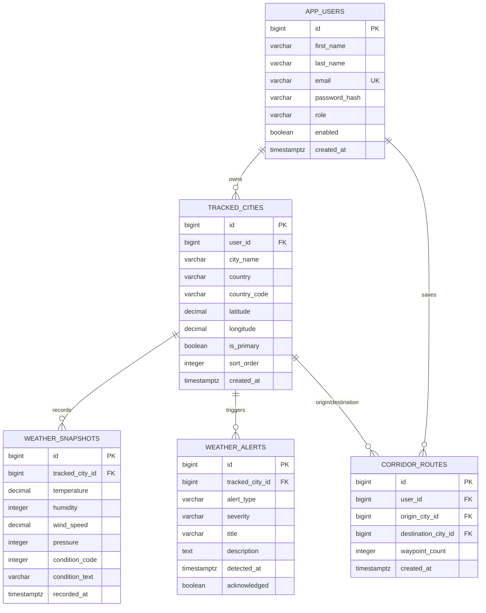

# 03 — Database Schema

Sky Track uses PostgreSQL 16. The schema is created and evolved by **Flyway migrations** — plain SQL files that run in order. Hibernate is set to `ddl-auto: validate`, meaning it never changes the schema; it only checks that the entities match the database. All schema changes must be new Flyway files.

## Entity relationship overview

## Tables, migration by migration

### V1 — `saved_locations` (later removed)

The first version of the app let anyone save a location globally. It had **no `user_id`** — a known design gap. This table is **dropped in V7** and replaced by `tracked_cities`.

### V2 — `app_users`

The user account table. Created with a single `full_name` column; **V8 later splits it** into `first_name` and `last_name`.

| Column | Purpose |
|--------|---------|
| `id` | Primary key |
| `email` | Unique login identifier (Spring Security uses it as username) |
| `password_hash` | BCrypt hash — never stored in plain text |
| `role` | Authority, e.g. `ROLE_USER` |
| `enabled` | Whether the account can log in |
| `created_at` | DB-managed timestamp |

### V3 — `tracked_cities`

A city the user chooses to track. This is the per-user replacement for `saved_locations`.

| Column | Purpose |
|--------|---------|
| `user_id` | FK to `app_users` — **scopes data per user** |
| `city_name`, `country`, `country_code` | Display metadata |
| `latitude`, `longitude` | Coordinates used to query OpenWeatherMap |
| `is_primary` | The city chosen during onboarding (only one per user) |
| `sort_order` | Order in the favorites carousel (added in V9) |

### V4 — `weather_snapshots`

A point-in-time recording of conditions for a tracked city. This is the heart of "tracking": snapshots accumulate so Sky Track can compute deltas and draw history.

| Column | Purpose |
|--------|---------|
| `tracked_city_id` | FK to `tracked_cities` |
| `temperature`, `feels_like`, `humidity`, `wind_speed`, `wind_direction`, `pressure`, `visibility` | Measured conditions |
| `condition_code`, `condition_text` | OpenWeatherMap weather id + description |
| `sunrise`, `sunset` | Local times |
| `recorded_at` | When the snapshot was taken — used for delta ordering |

### V5 — `weather_alerts`

Anomalies detected for a tracked city by the alert service.

| Column | Purpose |
|--------|---------|
| `alert_type` | e.g. `PRESSURE_DROP`, `WIND_SURGE` |
| `severity` | `LOW` / `MEDIUM` / `HIGH` |
| `title`, `description` | Human-readable message |
| `detected_at` | When detected |
| `acknowledged` | Whether the user dismissed it |

### V6 — `corridor_routes`

A saved travel corridor between an origin and a destination city.

| Column | Purpose |
|--------|---------|
| `user_id` | Owner |
| `origin_city_id`, `destination_city_id` | FK to `tracked_cities` |
| `waypoint_count` | How many stops were generated |

### V7 — drop `saved_locations`

Removes the old global table. Real development began after this, so no data migration was needed.

### V8 — `app_users` first/last name

Adds `first_name` and `last_name`, backfills them by splitting `full_name`, then drops `full_name`. This enables the greeting: *"Hi comrade {firstName}, Good {part}"*.

### V9 — `tracked_cities.sort_order`

Adds a sort order for the carousel and backfills it with the row id.

## Foreign keys and cascade behavior

- Deleting a user cascades to their `tracked_cities` and `corridor_routes`.
- Deleting a tracked city cascades to its `weather_snapshots` and `weather_alerts`.
- A corridor keeps origin/destination as `SET NULL` if the city is deleted.

## Repository mapping

Every table maps to a JPA entity in `sky-track-core/model/` and a repository in `sky-track-core/repository/`:

| Table | Entity | Repository |
|-------|--------|-----------|
| `app_users` | `AppUser` | `AppUserRepository` |
| `tracked_cities` | `TrackedCity` | `TrackedCityRepository` |
| `weather_snapshots` | `WeatherSnapshot` | `WeatherSnapshotRepository` |
| `weather_alerts` | `WeatherAlert` | `WeatherAlertRepository` |
| `corridor_routes` | `CorridorRoute` | `CorridorRouteRepository` |

## Why `created_at` is special

`created_at` columns are marked `insertable = false, updatable = false` in the entities. The database sets them via `DEFAULT NOW()`. JPA never writes them — this keeps timestamps consistent.

Next: [04-data-flows.md](04-data-flows.md)
