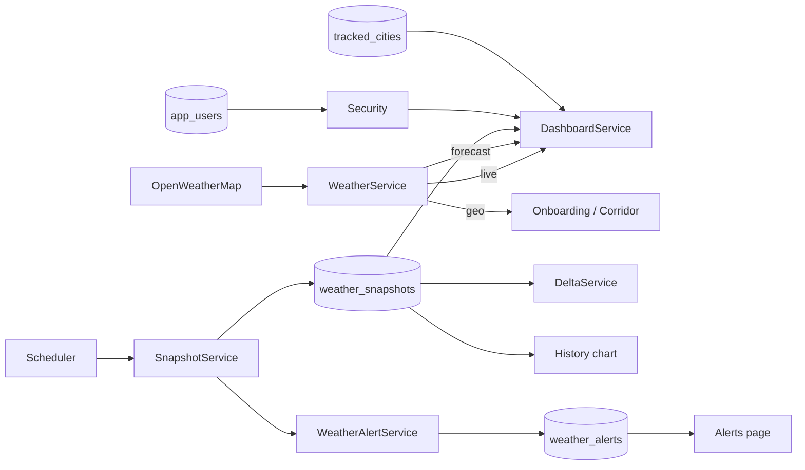

# 04 — Data Flows

This page traces the moving data through the system: where it comes from, how it is transformed, and where it is stored or displayed.

## Flow 1 — Live weather (current conditions)

```
HomeController.index
  └─ DashboardService.cityViews(user)
       └─ TrackedCityService.listCities(user)        → tracked_cities rows
       └─ WeatherService.currentWeather(lat, lon)    → OpenWeatherMap /data/2.5/weather
            └─ CurrentWeatherResponse (record)       → parsed JSON
       └─ TrackedCityView.from(city, weather)        → view DTO for the template
       └─ DeltaService.deltaFor(cityId)              → latest snapshots → temperature delta
```

Data travels: **database** (cities) + **external API** (weather) → **service** → **view DTO** → **Thymeleaf model** → **HTML**.

## Flow 2 — Snapshot ingestion (the scheduler)

```
SnapshotService.ingestAllCities()   (@Scheduled, every 30 min by default)
  └─ TrackedCityRepository.findAll()              → every city in the system
  └─ for each city:
       └─ WeatherService.currentWeather(lat, lon) → live reading
       └─ map to WeatherSnapshot entity
       └─ WeatherSnapshotRepository.save(...)     → INSERT into weather_snapshots
       └─ WeatherAlertService.evaluate(city, snapshot)
            └─ compare with previous snapshot
            └─ if pressure drop > 5 hPa  → create PRESSURE_DROP alert
            └─ if wind surge  > 12 m/s   → create WIND_SURGE alert
            └─ WeatherAlertRepository.save(...)
```

**Why it matters:** snapshots are the raw material for delta badges and history charts. Without them, Sky Track would only show a single live reading.

## Flow 3 — Delta ("Shift since last check")

```
DeltaService.deltaFor(cityId)
  └─ latest   = findFirstByTrackedCityIdOrderByRecordedAtDesc
  └─ previous = findFirstByTrackedCityIdAndRecordedAtBeforeOrderByRecordedAtDesc
  └─ compute: latest.temperature - previous.temperature  (and wind/pressure/humidity)
  └─ return DeltaView(temperatureDelta, since, currentTemperature, ...)
```

Rendered as a badge on the dashboard: `+0.00 C` / `-4.47 C`, colored green (up) or red (down).

## Flow 4 — Anomaly alerts

Triggered automatically by `SnapshotService` after each snapshot. `WeatherAlertService.evaluate` compares the new snapshot against the previous one and persists a `WeatherAlert` when a threshold is crossed. The `/alerts` page lists them; the user can acknowledge one (flips `acknowledged` to true).

## Flow 5 — Forecast (hourly + daily)

```
DashboardService.forecastFor(city)
  └─ WeatherService.forecast(lat, lon)          → OpenWeatherMap /data/2.5/forecast (free tier)
       └─ ForecastResponse (5-day / 3-hour list)
  └─ hourly: first 24 items → HourlyView
  └─ daily: group items by calendar day → DailyView (min/max/condition)
  └─ return ForecastBundle(hourly, daily)
```

Note: OpenWeatherMap **One Call 3.0** requires a paid subscription, so Sky Track uses the free `/data/2.5/forecast` endpoint instead.

## Flow 6 — History chart (historical playback)

```
history-chart.js (browser)
  └─ fetch /api/weather/{cityId}/snapshots?days=7
       └─ WeatherApiController.snapshots
            └─ DashboardService.historyFor(city, 7)
                 └─ WeatherSnapshotRepository.findByTrackedCityIdAndRecordedAtBetween
  └─ draws a line chart with a hover scrubber
```

## Flow 7 — City switching (dashboard interactions)

```
User taps a city card (dashboard.js)
  └─ read data-* attributes from the card
  └─ update the hero DOM (icon, temp, condition, metrics, delta)
  └─ toggle the 'active' class
```

This is a **client-side** switch — the page was already server-rendered with all cities' data in the HTML.

## Flow 8 — Travel corridor

```
POST /corridor (CorridorController.generate)
  └─ WeatherService.searchCities(origin)      → geocode origin
  └─ WeatherService.searchCities(destination) → geocode destination
  └─ CorridorService.generate(origin, dest)
       └─ interpolate 6 waypoints (0%, 20%, ..., 100% between coords)
       └─ WeatherService.currentWeather(lat, lon) at each waypoint
       └─ build CorridorPoint list
  └─ CorridorBundle(origin, destination, points) → corridor.html timeline
```

## Flow 9 — Authentication

```
POST /login
  └─ Spring Security DaoAuthenticationProvider
       └─ AppUserDetailsService.loadUserByUsername(email)
            └─ AppUserRepository.findByEmailIgnoreCase
            └─ returns UserDetails with BCrypt-hashed password
  └─ success → session → dashboard
```

Signup auto-login:
```
POST /signup
  └─ SignupService.createUser (BCrypt hash + save)
  └─ AuthenticationManager.authenticate
  └─ SecurityContextRepository.saveContext
  └─ redirect /onboarding
```

## One diagram, all flows



Next: [05-backend-map.md](05-backend-map.md)
