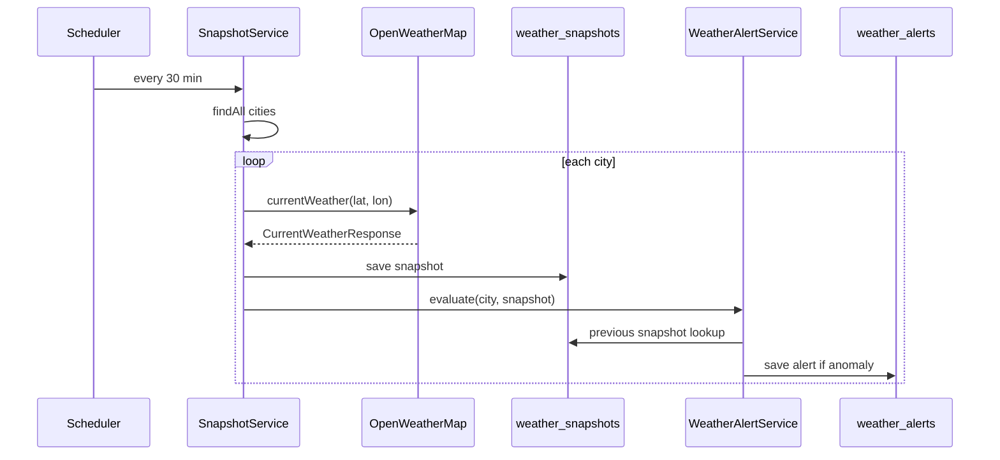

# 07 — Scheduling and Alerts

Sky Track records weather automatically on a schedule and watches for anomalies. This page explains `SchedulingConfig`, `SnapshotService`, and `WeatherAlertService`.

## SchedulingConfig — enabling the scheduler

```java
@Configuration
@EnableScheduling
public class SchedulingConfig {
}
```

`@EnableScheduling` tells Spring to look for `@Scheduled` methods and run them on a background thread pool.

## SnapshotService — recording weather

```java
@Service
public class SnapshotService {

    private final TrackedCityRepository trackedCityRepository;
    private final WeatherSnapshotRepository weatherSnapshotRepository;
    private final WeatherService weatherService;
    private final WeatherAlertService weatherAlertService;

    @Scheduled(fixedRateString = "${weather.snapshot.fixed-rate-ms:1800000}", initialDelay = 60000)
    @Transactional
    public void ingestAllCities() {
        trackedCityRepository.findAll().forEach(this::ingestCity);
    }

    @Transactional
    public WeatherSnapshot ingestCity(TrackedCity city) {
        CurrentWeatherResponse response = weatherService.currentWeather(
                city.getLatitude(), city.getLongitude());

        WeatherSnapshot snapshot = new WeatherSnapshot();
        snapshot.setTrackedCity(city);
        if (response.main() != null) {
            snapshot.setTemperature(response.main().temp());
            snapshot.setFeelsLike(response.main().feels_like());
            snapshot.setHumidity(response.main().humidity());
            snapshot.setPressure(response.main().pressure());
        }
        if (response.wind() != null) {
            snapshot.setWindSpeed(response.wind().speed());
            snapshot.setWindDirection(response.wind().deg());
        }
        snapshot.setVisibility(response.visibility());
        if (!response.weather().isEmpty()) {
            snapshot.setConditionCode(response.weather().get(0).id());
            snapshot.setConditionText(response.weather().get(0).description());
        }
        if (response.sys() != null) {
            snapshot.setSunrise(fromEpoch(response.sys().sunrise()));
            snapshot.setSunset(fromEpoch(response.sys().sunset()));
        }
        snapshot.setRecordedAt(OffsetDateTime.now(ZoneOffset.UTC));

        WeatherSnapshot saved = weatherSnapshotRepository.save(snapshot);
        weatherAlertService.evaluate(city, saved);
        return saved;
    }

    private OffsetDateTime fromEpoch(Long epoch) {
        return epoch != null
                ? OffsetDateTime.ofInstant(Instant.ofEpochSecond(epoch), ZoneOffset.UTC)
                : null;
    }
}
```

Key points:
- `@Scheduled(fixedRateString = "...", initialDelay = 60000)`:
  - runs **every 30 minutes** by default (configurable via `SNAPSHOT_FIXED_RATE_MS`),
  - waits **60 seconds** after startup before the first run, so the app has time to boot.
- `ingestAllCities` reads **every tracked city in the system** (all users) and snapshots each one.
- `ingestCity` maps the OpenWeatherMap response into a `WeatherSnapshot`, saves it, then calls the alert check.

## Why snapshots matter

A snapshot is a **point-in-time recording**. By accumulating snapshots, Sky Track can:

- compute the **delta** ("Shift since last check") in `DeltaService`,
- draw the **history chart** in Zone 3,
- detect **anomalies** by comparing consecutive readings.

## WeatherAlertService — anomaly detection

```java
@Service
public class WeatherAlertService {

    private static final BigDecimal PRESSURE_DROP_THRESHOLD = BigDecimal.valueOf(5);
    private static final BigDecimal WIND_SURGE_THRESHOLD = BigDecimal.valueOf(12);

    private final WeatherAlertRepository weatherAlertRepository;
    private final WeatherSnapshotRepository weatherSnapshotRepository;

    @Transactional
    public void evaluate(TrackedCity city, WeatherSnapshot latest) {
        Optional<WeatherSnapshot> previousOpt = weatherSnapshotRepository
                .findFirstByTrackedCityIdAndRecordedAtBeforeOrderByRecordedAtDesc(
                        city.getId(), latest.getRecordedAt());
        if (previousOpt.isEmpty()) {
            return;   // first snapshot for this city — nothing to compare
        }

        WeatherSnapshot previous = previousOpt.get();
        checkPressureDrop(city, latest, previous);
        checkWindSurge(city, latest, previous);
    }

    private void checkPressureDrop(TrackedCity city, WeatherSnapshot latest, WeatherSnapshot previous) {
        if (latest.getPressure() == null || previous.getPressure() == null) {
            return;
        }
        BigDecimal drop = BigDecimal.valueOf(previous.getPressure() - latest.getPressure());
        if (drop.compareTo(PRESSURE_DROP_THRESHOLD) >= 0) {
            createAlert(city, "PRESSURE_DROP", "HIGH",
                    "Rapid pressure drop",
                    "Pressure fell " + drop + " hPa for " + city.getCityName());
        }
    }

    private void checkWindSurge(TrackedCity city, WeatherSnapshot latest, WeatherSnapshot previous) {
        if (latest.getWindSpeed() == null || previous.getWindSpeed() == null) {
            return;
        }
        BigDecimal surge = latest.getWindSpeed().subtract(previous.getWindSpeed());
        if (surge.compareTo(WIND_SURGE_THRESHOLD) >= 0) {
            createAlert(city, "WIND_SURGE", "MEDIUM",
                    "Sudden wind increase",
                    "Wind speed rose " + surge + " m/s for " + city.getCityName());
        }
    }

    private void createAlert(TrackedCity city, String alertType, String severity,
                             String title, String description) {
        WeatherAlert alert = new WeatherAlert();
        alert.setTrackedCity(city);
        alert.setAlertType(alertType);
        alert.setSeverity(severity);
        alert.setTitle(title);
        alert.setDescription(description);
        alert.setDetectedAt(OffsetDateTime.now());
        alert.setAcknowledged(false);
        weatherAlertRepository.save(alert);
    }
}
```

## The thresholds

| Check | Condition | Alert |
|-------|-----------|-------|
| Pressure drop | previous pressure − latest pressure ≥ 5 hPa | `PRESSURE_DROP`, HIGH |
| Wind surge | latest wind − previous wind ≥ 12 m/s | `WIND_SURGE`, MEDIUM |

The comparison is always against the **previous snapshot** (the latest one recorded before the new one), so it detects *change*, not absolute values.

## The full ingestion pipeline



## Test your understanding

**Q1. What does `initialDelay = 60000` achieve?**
**A.** It delays the first run for 60 seconds after startup, giving the application (and any migrations) time to finish before the scheduler starts hitting OpenWeatherMap.

**Q2. Why does `ingestAllCities` use `trackedCityRepository.findAll()` instead of a per-user query?**
**A.** This is a system-wide background job: it must snapshot every tracked city for every user, so it deliberately bypasses the per-user scoping used by controllers.

**Q3. What happens the very first time a city is snapshotted?**
**A.** `weatherAlertService.evaluate` finds no previous snapshot (`Optional.empty()`) and returns without creating an alert. One snapshot alone cannot prove a "change".

**Q4. Why is `evaluate` `@Transactional`?**
**A.** It reads the previous snapshot and writes an alert inside one transaction, keeping the read-and-check consistent and ensuring the lazy `TrackedCity` relation resolves.

**Q5. If pressure drops from 1015 to 1011 hPa between consecutive snapshots, what happens?**
**A.** `drop = 1015 − 1011 = 4`, which is below the threshold of 5, so **no** alert. If it dropped to 1010 (drop = 5), a `PRESSURE_DROP` HIGH alert would be created.

**Q6. How does the delta feature differ from anomaly detection, even though both compare snapshots?**
**A.** Delta (`DeltaService`) is a *display metric* computed on demand when a user views the dashboard ("shift since last check"). Anomaly detection (`WeatherAlertService`) runs automatically during ingestion and *persists* an alert row when a threshold is crossed.
