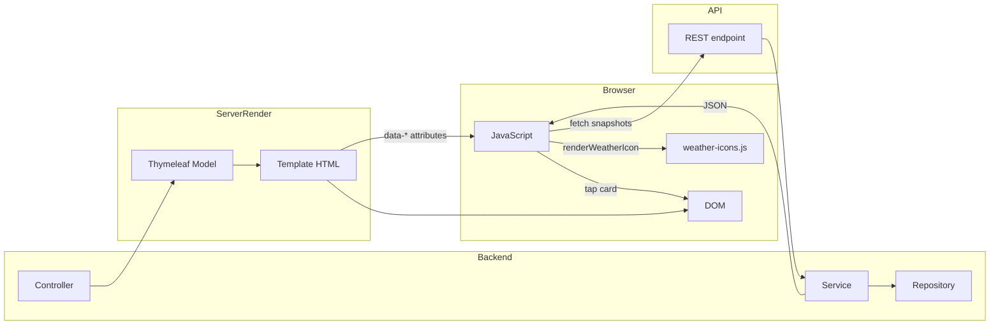

# 05 — Data Flow to the Frontend

This page traces how data travels from the backend into the HTML and then into JavaScript. Understanding this end-to-end path is the key to working on any page.

## The two channels

1. **Server-rendered (Thymeleaf model → HTML)** — used by all pages for initial content.
2. **REST API → JavaScript `fetch`** — used only by the history chart (so far).

## Channel 1: server-rendered

### Step 1 — The controller builds the model

`HomeController.index` adds every piece of data the template needs:

```java
model.addAttribute("greeting", greetingService.greeting(user, LocalTime.now()));
model.addAttribute("themeClass", greetingService.themeClass(LocalTime.now()));
model.addAttribute("firstName", user.getFirstName());
model.addAttribute("alerts", weatherAlertRepository.findAllByTrackedCityUserIdOrderByDetectedAtDesc(user.getId()));

List<TrackedCityView> cities = dashboardService.cityViews(user);
model.addAttribute("cities", cities);
model.addAttribute("primaryCityView", dashboardService.primaryCityView(user));
model.addAttribute("cityMessage", ...);
model.addAttribute("forecast", dashboardService.forecastFor(city));
model.addAttribute("history", dashboardService.historyFor(city, 7));
```

### Step 2 — Thymeleaf renders the model into HTML

```html
<h2 id="hero-city" class="city-name" th:text="${primaryCityView.cityName}">Lagos</h2>
<p id="hero-temp" class="hero-temp" th:text="${primaryCityView.temperature} != null ? ${primaryCityView.temperature} + ' C' : '--'">28 C</p>
```

- `th:text` replaces the fallback text with the rendered value.
- The `<body>` class carries the theme:
  ```html
  <body th:class="${themeClass}">
  ```

### Step 3 — Data is also embedded as attributes for JavaScript

The same city data that renders the hero is placed on each card as `data-*` attributes:

```html
<article class="glass-card city-card"
         th:data-name="${city.cityName}"
         th:data-temp="${city.temperature}"
         th:data-icon="${city.conditionCode}"
         th:data-delta="${city.temperatureDelta}"
         th:classappend="${city.primaryCity} ? ' active'">
```

### Step 4 — JavaScript reads the embedded data

`dashboard.js`:
```js
const city = card.dataset;
heroFields.city.textContent = city.name;
heroFields.temp.textContent = city.temp ? city.temp + ' C' : '--';
```

**The key idea:** the page ships *with* its data. JavaScript only moves it around the DOM — it does not re-fetch.

## Channel 2: REST API → fetch

The history chart is the exception. Its data set is large (7 days of snapshots) and only needed in one place, so it is fetched on demand:

```js
fetch('/api/weather/' + cityId + '/snapshots?days=7')
    .then((response) => response.json())
    .then((data) => {
        points = data;
        draw();
    });
```

```
GET /api/weather/1/snapshots?days=7
  → WeatherApiController.snapshots
    → DashboardService.historyFor(city, 7)
      → WeatherSnapshotRepository.findByTrackedCityIdAndRecordedAtBetween
  → List<SnapshotView> as JSON
  → history-chart.js draws the line chart
```

## Full flow diagram



## End-to-end example: the greeting

1. `GreetingService.greeting(user, LocalTime.now())` → `"Hi comrade John, Good morning"`.
2. `HomeController` adds it to the model.
3. `topbar` fragment renders it:
   ```html
   <p class="greeting" th:text="${greeting}">Hi comrade, Good morning</p>
   ```
4. CSS applies `--font-script` (Playfair) → elegant script greeting.
5. `clock.js` updates the live time next to it.

## End-to-end example: switching the hero city

1. The page rendered all cities' data on their cards (Channel 1).
2. User taps the "Paris" card.
3. `dashboard.js` reads `card.dataset` (name=Paris, temp=15.78, icon=801, ...).
4. It writes those values into the hero fields and re-renders the icon via `renderWeatherIcon`.
5. No network request — instant.

## End-to-end example: the history chart

1. Page loads, `history-chart.js` finds the canvas and its `data-city-id`.
2. It fetches `/api/weather/{id}/snapshots?days=7` (Channel 2).
3. `DashboardService.historyFor` reads snapshots from the database.
4. The chart draws temperature over time with a hover scrubber.

## What each page receives from the backend

| Page | Model data | JS-driven data |
|------|-----------|----------------|
| `index.html` | greeting, cities, primaryCityView, forecast, history, cityMessage, searchResults, alerts | snapshots (chart) |
| `onboarding.html` | greeting, results, query | — |
| `corridor.html` | greeting, corridor | — |
| `alerts.html` | greeting, alerts | — |
| `login.html` / `signup.html` | themeClass | — |

## Test your understanding

**Q1. Why does the dashboard ship all city data in the HTML instead of loading it with fetch?**
**A.** Server-rendering is faster for initial paint and needs no loading spinners. Embedding data in `data-*` attributes lets the tap-to-switch work instantly without extra requests.

**Q2. What is the single exception to "no fetch in the frontend"?**
**A.** The history chart: it fetches `/api/weather/{cityId}/snapshots?days=7` because the snapshot series is large and only needed for that one widget.

**Q3. How does `dashboard.js` get the city id or coordinates?**
**A.** It does not need them — switching is purely presentational. Only the history chart needs an id, which it reads from the canvas's `data-city-id`.

**Q4. What would happen if a template referenced `${cities}` but the controller forgot to add it?**
**A.** Thymeleaf would throw an error rendering the page (unless the value is guarded). That is why the controller and template must stay in sync — a documented contract between backend and frontend.

**Q5. Why is the theme a body class rather than inline styles?**
**A.** A single class triggers the whole token cascade (all `var(--color-*)` update at once), keeps styling in CSS where it belongs, and lets `liquid.js` read the same variables for the background.

**Q6. Trace the data for the hero temperature from database to screen.**
**A.** OpenWeatherMap `/weather` → `WeatherService.currentWeather` → `CurrentWeatherResponse` → `DashboardService.enrich` builds `TrackedCityView` → `HomeController` adds it to the model → `index.html` `th:text="${primaryCityView.temperature} + ' C'"` → browser displays `24.57 C`; on card tap, `dashboard.js` reads `data-temp` and writes it into `#hero-temp`.
